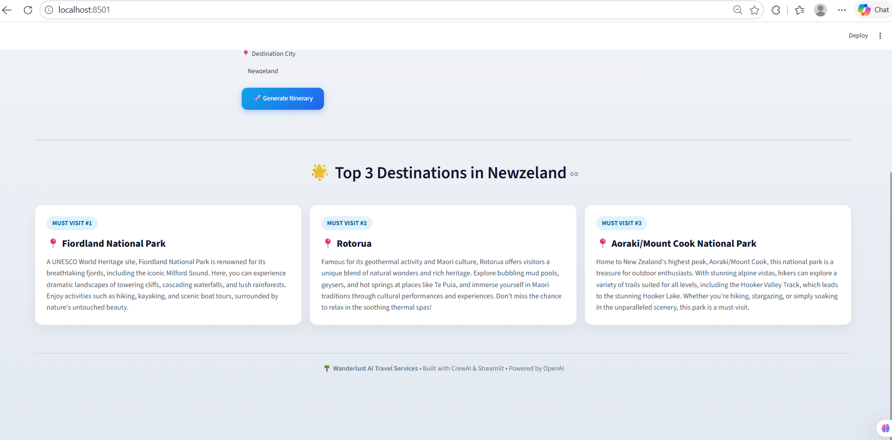
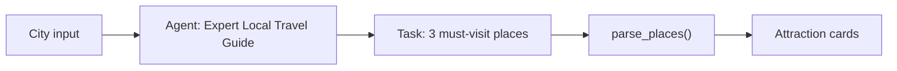

# Wanderlust: CrewAI Travel Planner Agent

> Type a city and an AI travel-guide agent suggests the top 3 places to visit.

    

## Overview

A single-agent [CrewAI](https://www.crewai.com/) app. An *Expert Local Travel Guide* agent receives a city and returns exactly 3 must-visit places with short descriptions. The output is parsed and shown as attraction cards in a travel-site style Streamlit UI.

## Features

- CrewAI agent + task with a strict expected output (3 places)
- Output parsing into structured cards
- Polished Streamlit UI with hero banner and animations
- Works for any city worldwide

## Demo



## How it works



## Tech stack

| Layer | Technology |
|---|---|
| Agents | CrewAI |
| LLM | OpenAI |
| UI | Streamlit |

## Project structure

```text
.
├── travel-planner.py
├── requirements.txt
├── .env.example
└── Traveler_agent.png
```

## Getting started

**Prerequisites:** Python 3.10+

```bash
git clone https://github.com/prasanth-sundararajan/CrewAI-Travel-Planner-Agent.git
cd CrewAI-Travel-Planner-Agent
python -m venv .venv
# Windows: .venv\Scripts\activate    macOS/Linux: source .venv/bin/activate
pip install -r requirements.txt
```

Copy `.env.example` to `.env` and add your keys:

```bash
cp .env.example .env
```

## Usage

```bash
streamlit run travel-planner.py
```
Enter a city (e.g. *Jaipur*, *Tokyo*) and click **Generate Itinerary**.

## Configuration

| Variable | Required | Description |
|---|---|---|
| `OPENAI_API_KEY` | Yes | OpenAI API key used for chat and embeddings |

## License

Released under the [MIT License](LICENSE).

## Author

**Prasanth Sundararajan**, Senior SRE and AI Engineer  
[LinkedIn](https://www.linkedin.com/in/prasanth-s-a093a7109/) · [GitHub](https://github.com/prasanth-sundararajan)
